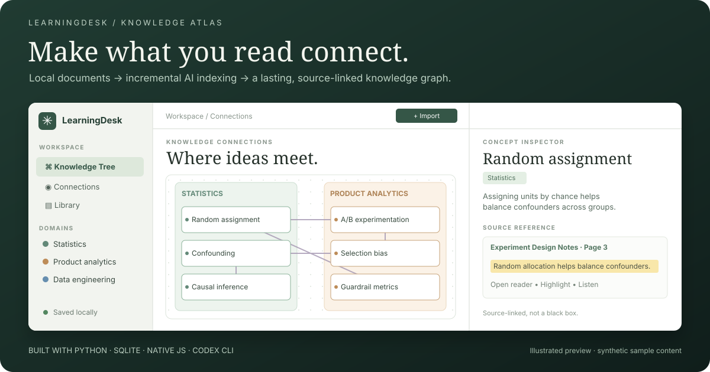
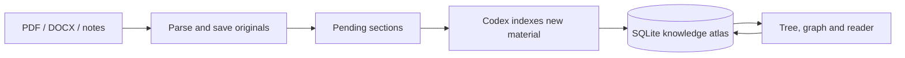

# LearningDesk 2.0 — Knowledge Atlas

**Information is easy to access. Understanding takes a little more work.**



*Illustrated preview with synthetic sample concepts; never taken from a personal library.*

## Why I built this

AI has made information incredibly easy to access. The hard part is turning all that information into something I actually understand and remember. I would read a textbook, ask AI to explain a concept, learn something interesting, and a few days later struggle to remember where I had seen it or how it fit into the bigger picture.

I wanted a place where what I learn can accumulate. LearningDesk keeps the useful concepts from my documents, organizes them into a navigable knowledge tree, and connects ideas that appear across different subjects. I can return to the original passage, see how far I've worked through a material, and build on knowledge I already extracted instead of starting over with every new AI session.

## What it does

LearningDesk is a local workspace for documents, datasets, videos, audio and notes. Codex reads new material, creates source-linked concepts and learning roadmaps, and merges overlapping concepts into the existing atlas. The reader, graph, flashcards and library let me revisit and use what I've learned.

Local-first · Python + SQLite · Native JavaScript · Codex CLI · MIT

No website hosting, API key or separate OpenAI API billing is needed. The Codex CLI uses your signed-in ChatGPT account and its applicable usage limits for analysis.

## How it works



## First launch (Mac)

1. Clone or unzip into a permanent folder. For example:

   ```sh
   git clone https://github.com/zhen01/learningdesk-knowledge-atlas.git ~/Documents/LearningDesk2
   cd ~/Documents/LearningDesk2
   ```
2. Open Terminal and enter `cd ~/Documents/LearningDesk2` (change the path if needed).
3. Run `bash setup.command`. Python 3 must be installed. This installs two document parsing libraries.
4. Run `bash "Start LearningDesk.command"` in Terminal. The local interface opens at http://127.0.0.1:8765. Keep its Terminal window open. macOS may block double-clicked downloaded scripts, so use Terminal.
5. Import a document, dataset or media file through the interface or drag files into the `inbox` directory.
6. Open a second Terminal in this folder and run `bash "Index with Codex.command"` or open Codex CLI and ask: **Index all pending learning materials according to AGENTS.md.** Sign in with ChatGPT (not an API key). Review any file write approvals Codex requests.
7. Refresh LearningDesk when indexing finishes.

## Update an existing installation (preserve your atlas)

Stop the local server and any active indexing session. If your installation is a Git clone, run `git pull` in the original folder. If you downloaded an older ZIP, download the latest source into a **different** folder, then run the updater from that new folder:

```sh
python3 update_existing.py ~/Downloads/LearningDesk2
```

Change the destination to your actual existing installation folder. The updater copies only an explicit list of application source files and takes a SQLite backup first. It never replaces your existing database, originals, inbox or virtual environment. Never unzip into a new folder and expect the old database to follow automatically. For full disaster recovery, also keep an independent copy of your entire original folder.

After this first upgrade, future updates are one command from your original folder:

```sh
bash "Update LearningDesk.command"
```

Stop the server and indexing sessions first. The updater downloads the latest public source and copies only allowed application files into the existing folder. Restart using `bash "Start LearningDesk.command"`.

The app automatically creates a SQLite backup before the reader schema upgrade and once per day before indexing. You can also run `.venv/bin/python atlas.py backup`. All updates are incremental: previously processed sections are skipped, existing concept definitions and source references remain, and duplicate uploads reuse the existing document hash.

## Inside the workspace

- **Knowledge Tree**: domains, modules, submodules, concepts. Expand/collapse, search ideas, and click a concept to view its references.
- **Connections**: spaced, grouped domain layout with zoom and pan, domain filters, cross-domain relationships, and a focused one-hop neighborhood mode. Click a card or a relationship line.
- **Library**: original documents, datasets, videos, audio, and images; custom collections and multiple collection tags per file; file type and filename filters.
- **Reader**: read extracted PDF pages, DOCX paragraphs, or text sections, jump to source citations, save color highlights and notes, resume the last section, and listen using available local system voices. Open the original PDF beside the extracted text for layout context. Highlights belong to the extracted text, not the PDF's native annotation layer. Listen reads the current section; choose a voice and speed before starting.

- **Flashcards**: import your own decks, practice recall and save what you know.

When you import a second textbook, Codex reads the existing catalog and integrates overlapping content, preserving each document's evidence. The application checks that quotes match the parsed source. It does not generate sample concepts or fabricate an atlas.

## Storage and limitations

`data/atlas.sqlite` stores extracted sections, concepts, placements, source references and connections. `data/originals/` contains untouched source files, deduplicated by file hash. Back up the whole folder (stop the server before making a manual copy). Do not delete or move this data directory independently of the project.

The server listens only on loopback; it is accessible to processes and users on the same computer, and has no separate login. It does not sync across devices. Python parsing happens locally; the AI analysis handled by Codex may send source excerpts to ChatGPT subject to your account's data settings. Only import materials you are permitted to process.

Text-bearing PDFs are supported; scanned or image-only PDFs need OCR first. DOCX paragraphs and tables are parsed, not embedded images. Source references use PDF pages, DOCX paragraph/table numbers, and text line ranges. Complex tables, equations and multi-column PDFs may require manual review.

## Supported materials

| Format | Reader | Codex indexing |
|---|---|---|
| PDF, DOCX, Markdown, TXT | Extracted text, highlights, notes, local speech | Yes |
| PPTX | Slide-by-slide extracted text, original deck download | Yes |
| CSV, JSON, HTML | Readable, parsed sections | Yes |
| SRT, VTT | Subtitle text and timestamped sections | Yes |
| MP4, WebM, MOV, M4V | Browser video player, saved playback position | Attach a transcript |
| MP3, WAV, M4A, OGG, FLAC, AAC | Browser audio player, saved playback position | Attach a transcript |
| PNG, JPEG, WebP, GIF | Image viewer | OCR not included |

Media playback depends on browser codec support. For video/audio, attach an existing SRT, VTT, TXT or Markdown transcript in the reader. Timestamped transcript sections link back to playback positions. Transcript indexing is incremental and never rewrites previous source references. Automatic speech-to-text, OCR, streamed website videos and DRM-protected video are not supported. Browser imports support text files up to 100 MB and media files up to 1 GB; use the inbox for larger local media. Processing media does not require an API key.

Default collections are Career, Product Data Science, Textbook Knowledge, and Fun Knowledge. Create your own and assign more than one collection to a material. Existing materials initially remain Unsorted until you classify them; collections are independent from AI-generated domains and do not change knowledge nodes or existing source evidence.

## Study workspace

### Content-based learning roadmaps

Open **Learning roadmap** from a material's Library card or reader. During indexing, Codex organizes the actual contents into meaningful modules with learning outcomes and source references. Check off modules as you learn, or expand the source sections. Original source labels preserve existing checkmarks through updates. The roadmap does not invent a generic curriculum or arbitrary page groups.

Import your own study plan as a document and let Codex follow its existing sequence. Continue using your preferred external coding practice platforms. The app focuses on reading and retaining the material; coding drills and interview practice can stay in the tools you already use.

After updating, run Index with Codex once. Missing roadmaps for previously indexed materials are created from saved concept explanations and source evidence without re-extracting existing knowledge. New materials get a roadmap as part of their normal index pass.

- Rename materials using their display names; original filenames, source IDs and AI evidence remain unchanged.
- Save per-material notes, estimated reading/playback progress and manual completion. Completion is explicit; position is not a measure of comprehension.
- DOCX opens as continuous extracted text by default. Switch between continuous and section view. Select within a source section to highlight.
- Use Full screen / focus to hide the workspace chrome, or Full-page PDF to read the original PDF in an expanded viewer. PPTX displays extracted slide text; open the original in PowerPoint or Keynote for exact artwork and animations.
- Flashcards: import CSV or TSV with Front and Back columns, or a JSON array of objects with front and back fields. Flip cards, mark known or review again, and keep deck progress across sessions. Reimporting identical cards preserves their status.

## Move your library between computers

For a free, manual handoff, stop the server and indexing, then export a portable ZIP:

```sh
.venv/bin/python atlas.py export-library ~/Desktop/LearningDesk-library.zip
```

Transfer the ZIP using external storage or a private cloud drive you already use (subject to its storage quota). On the other machine, install LearningDesk and stop its server, extract the ZIP into a new temporary folder, then copy its data and inbox folders into an **empty** installation. If the destination already has a library, back it up and do not overwrite it; independent libraries are not automatically merged. Never sync the live SQLite/WAL database while it is open, and never commit exported libraries to public GitHub.

Indexing is initiated by you through Codex, not a continuously running autonomous service. Large books may require several sessions due to model context or account limits; pending sections can be resumed. Deduplication and connections depend on the quality of Codex's analysis. Graph visualization can become crowded with very large collections; use the domain and focus filters. The local server itself makes no external network calls.

## Development

```sh
python3 -m pip install -r requirements-dev.txt
python3 -m unittest -v test_atlas
```

The public repository contains application code and synthetic test fixtures only. Documents, the SQLite database, backup snapshots and user annotations stay on the user's computer and are excluded by `.gitignore`.

MIT license.
