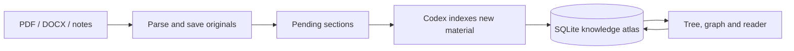

# LearningDesk 2.0 — Knowledge Atlas

**Make what you read connect.**


*Illustrated preview with synthetic sample concepts; never taken from a personal library.*

LearningDesk turns a collection of PDFs, documents and notes into a continuously growing, source-linked atlas. Instead of asking an AI to summarize the same textbook again, keep the extracted knowledge, discover connections to other subjects, and return to the original passage whenever you need context.

Local-first · Python + SQLite · Native JavaScript · Codex CLI · MIT

No website hosting, API key or separate OpenAI API billing is needed. The Codex CLI uses your signed-in ChatGPT account and its applicable usage limits for analysis.

## How it works



## First launch (Mac)

1. Clone or unzip into a permanent folder. For example:

   ```sh
   git clone https://github.com/zhen01/learningdesk-knowledge-atlas.git ~/Documents/LearningDesk2
   cd ~/Documents/LearningDesk2
   ```
2. Open Terminal and enter `cd ~/Documents/LearningDesk2` (change the path if needed).
3. Run `bash setup.command`. Python 3 must be installed. This installs two document parsing libraries.
4. Run `bash "Start LearningDesk.command"` in Terminal. The local interface opens at http://127.0.0.1:8765. Keep its Terminal window open. macOS may block double-clicked downloaded scripts, so use Terminal.
5. Import a PDF, DOCX, Markdown or TXT file through the interface or drag files into the `inbox` directory.
6. Open a second Terminal in this folder and run `bash "Index with Codex.command"` or open Codex CLI and ask: **Index all pending learning materials according to AGENTS.md.** Sign in with ChatGPT (not an API key). Review any file write approvals Codex requests.
7. Refresh LearningDesk when indexing finishes.

## Update an existing installation (preserve your atlas)

Stop the local server and any active indexing session. If your installation is a Git clone, run `git pull` in the original folder. If you downloaded an older ZIP, download the latest source into a **different** folder, then run the updater from that new folder:

```sh
python3 update_existing.py ~/Downloads/LearningDesk2
```

Change the destination to your actual existing installation folder. The updater copies only an explicit list of application source files and takes a SQLite backup first. It never replaces your existing database, originals, inbox or virtual environment. Never unzip into a new folder and expect the old database to follow automatically. For full disaster recovery, also keep an independent copy of your entire original folder.

The app automatically creates a SQLite backup before the reader schema upgrade and once per day before indexing. You can also run `.venv/bin/python atlas.py backup`. All updates are incremental: previously processed sections are skipped, existing concept definitions and source references remain, and duplicate uploads reuse the existing document hash.

## Four views

- **Knowledge Tree**: domains, modules, submodules, concepts. Expand/collapse, search ideas, and click a concept to view its references.
- **Connections**: spaced, grouped domain layout with zoom and pan, domain filters, cross-domain relationships, and a focused one-hop neighborhood mode. Click a card or a relationship line.
- **Library**: original documents, local import status, source downloads, and access to the reader.
- **Reader**: read extracted PDF pages, DOCX paragraphs, or text sections, jump to source citations, save color highlights and notes, resume the last section, and listen using available local system voices. Open the original PDF beside the extracted text for layout context. Highlights belong to the extracted text, not the PDF's native annotation layer. Listen reads the current section; choose a voice and speed before starting.

When you import a second textbook, Codex reads the existing catalog and integrates overlapping content, preserving each document's evidence. The application checks that quotes match the parsed source. It does not generate sample concepts or fabricate an atlas.

## Storage and limitations

`data/atlas.sqlite` stores extracted sections, concepts, placements, source references and connections. `data/originals/` contains untouched source files, deduplicated by file hash. Back up the whole folder (stop the server before making a manual copy). Do not delete or move this data directory independently of the project.

The server listens only on loopback; it is accessible to processes and users on the same computer, and has no separate login. It does not sync across devices. Python parsing happens locally; the AI analysis handled by Codex may send source excerpts to ChatGPT subject to your account's data settings. Only import materials you are permitted to process.

Text-bearing PDFs are supported; scanned or image-only PDFs need OCR first. DOCX paragraphs and tables are parsed, not embedded images. Source references use PDF pages, DOCX paragraph/table numbers, and text line ranges. Complex tables, equations and multi-column PDFs may require manual review.

Indexing is initiated by you through Codex, not a continuously running autonomous service. Large books may require several sessions due to model context or account limits; pending sections can be resumed. Deduplication and connections depend on the quality of Codex's analysis. Graph visualization can become crowded with very large collections; use the domain and focus filters. The local server itself makes no external network calls.

## Development

```sh
python3 -m pip install -r requirements-dev.txt
python3 -m unittest -v test_atlas
```

The public repository contains application code and synthetic test fixtures only. Documents, the SQLite database, backup snapshots and user annotations stay on the user's computer and are excluded by `.gitignore`.

MIT license.
